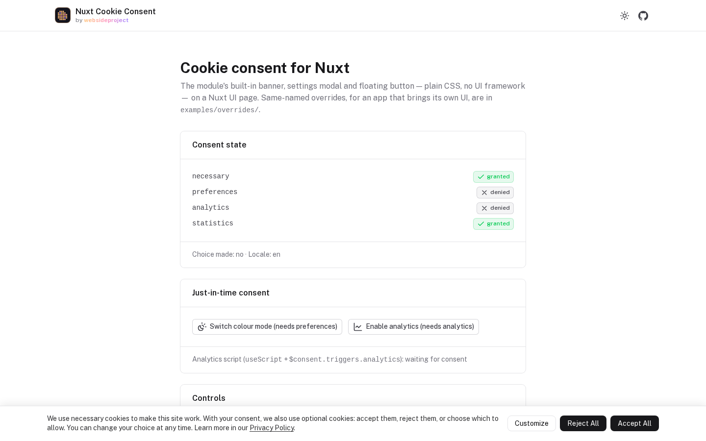
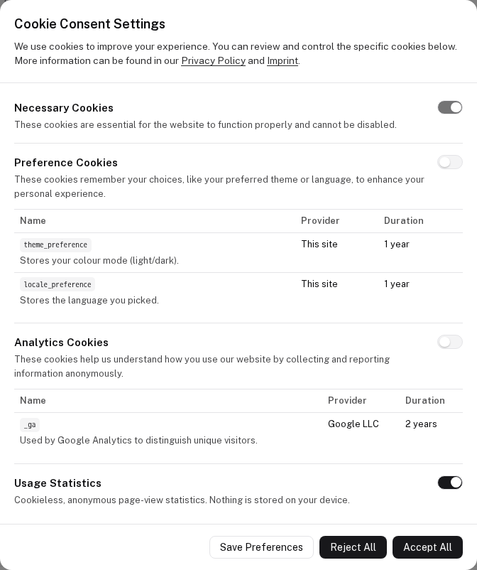
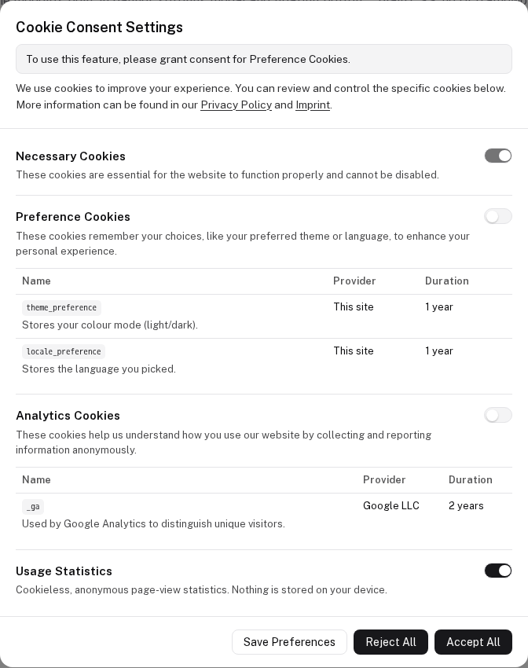
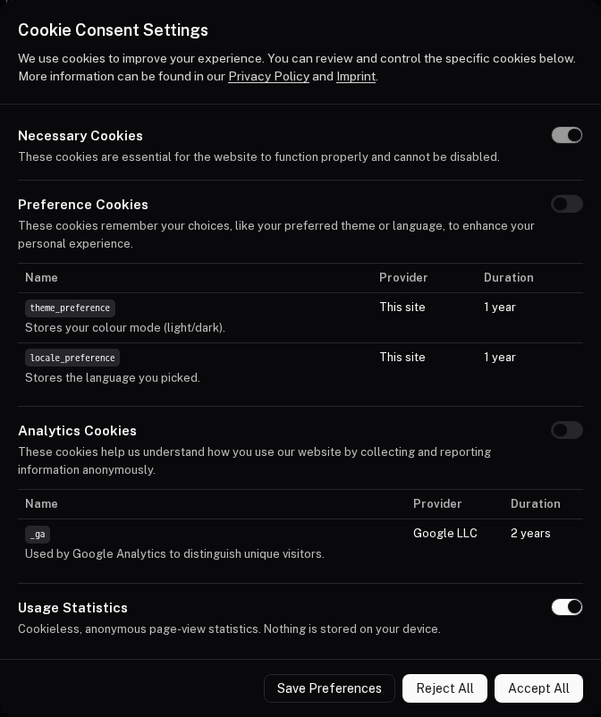

# @websideproject/nuxt-cookie-consent

[](https://npmjs.com/package/@websideproject/nuxt-cookie-consent)
[](https://npm.chart.dev/@websideproject/nuxt-cookie-consent)
[](https://github.com/websideproject/nuxt-cookie-consent/blob/main/LICENSE)

Cookie and cookieless-tracking consent for Nuxt 4. Declare your categories in `nuxt.config.ts` and get a banner that
only appears when something actually needs consent, a preferences modal, a floating settings button, and composables
to gate scripts and cookies behind each category.

- **Banner only when needed** — it appears on the first visit only if a configured category requires it
- **Cookies and cookieless tracking** — `kind: 'cookie'` categories list provider and duration; `kind: 'tracking'` ones (e.g. cookieless analytics) are a plain toggle, opt-out by default
- **Just-in-time consent** — `useRequestConsent` asks for one category at the moment a feature needs it
- **Consent-gated cookies and scripts** — `useConsentCookie` writes only after consent; `$consent.triggers.<category>` loads a script through [Nuxt Scripts](https://scripts.nuxt.com) once granted
- **No UI framework required** — the default components are plain CSS themed from your `colors`; override any of them with a same-named component in your own UI kit
- **Headless** — use `$consent` and the composables as the consent store and render your own UI, or none
- **Translatable** — every text, including categories, with runtime locale switching; English, German, Spanish and French built in

> **Disclaimer:** This module provides tools to help you comply with privacy regulations like GDPR, but using it does not automatically guarantee compliance. You are solely responsible for ensuring your website's configuration, cookie descriptions, and overall privacy practices are compliant with all applicable laws in your users' jurisdictions. The author assumes no liability for any legal issues arising from its use. Always consult a legal professional for matters of legal compliance.

## Install

```bash
npm install @websideproject/nuxt-cookie-consent @nuxt/scripts
```

```ts
// nuxt.config.ts
export default defineNuxtConfig({
  modules: ['@websideproject/nuxt-cookie-consent'],
})
```

The module registers [`@nuxt/scripts`](https://scripts.nuxt.com) (a peer dependency, `^1.0.0`) for you, so
`useScript` and the consent triggers work without adding it to `modules`.

## Configuration

### Granular banner control (`requiresBanner`)

The module shows the initial consent banner *only if necessary*, controlled by the `requiresBanner` property on individual cookie definitions.

- A non-essential cookie that **requires** a banner (analytics, marketing): omit the property or set `requiresBanner: true` (the default).
- A non-essential cookie that should **not** trigger a banner (e.g. a theme preference set on-demand): set `requiresBanner: false`. Use `useConsentCookie` to manage such cookies so they are written only after consent.

If **all** non-essential cookies set `requiresBanner: false`, no banner shows on first visit — only the floating settings button appears.

This is how a theme or language preference works without a banner: nothing is stored on the first visit; when the
visitor first switches the theme or the language, `useRequestConsent('preferences')` opens the modal, and the cookie
is written only on a yes (the language can still change for the visit on a no — only remembering it needs the
cookie). See [Preferences without a banner](https://websideproject.com/docs/nuxt-cookie-consent/guide/usage#preferences-without-a-banner-theme-language).

### Cookie vs cookieless tracking categories (`kind`)

A category declares what it represents:

- **`kind: 'cookie'`** (default) — backed by real device storage. The modal renders the provider/duration **table** from its `cookies[]`. The per-cookie `requiresBanner` heuristic decides the banner.
- **`kind: 'tracking'`** — a non-cookie item (e.g. cookieless analytics like Umami). No `cookies[]` is needed; the modal renders a labeled **toggle + `description`** with no table. A tracking category shows the banner **only** when you set its category-level `requiresBanner: true` — so cookieless analytics defaults to an opt-out (no banner), not a forced opt-in.

```ts
categories: {
  analytics: {
    kind: 'tracking',
    requiresBanner: false, // opt-out: no banner, just the FAB/settings toggle
    description: 'Cookieless, anonymous usage analytics. No cookie, no persistent identifier.',
  },
}
```

Category-level fields: `kind?`, `description?` (a string, or one per locale), `requiresBanner?` (the last overrides the per-cookie heuristic for `cookie` categories too), `defaultEnabled?`.

### Default state (`defaultEnabled`)

Before a visitor chooses, `necessary` is on, a `kind: 'tracking'` category **without** a banner is **on** (that is
the opt-out), and everything else is off. `defaultEnabled` overrides it per category — `defaultEnabled: false` on a
tracking category gives an **opt-in without a banner** (e.g. session replays: off until switched on from the FAB).

### Dark mode (`darkColors`)

The default components switch to `darkColors` under a `.dark` ancestor — the class Nuxt's color mode (and Nuxt UI)
puts on `<html>`. The default is a dark neutral palette; set your own, or `darkColors: false` to keep `colors` in
both modes.

### Translated providers and durations

A cookie's `provider` and `duration` (and a category's `description`) are a string, or one per locale:
`duration: { en: '1 year', de: '1 Jahr' }`. Custom components render them with `useConsentLocalized(value)`.

### Reject All

The banner and the modal offer **Reject All** beside **Accept All**, styled the same, so refusing is as easy as
accepting. It withdraws every category that is not `readonly`, opt-out tracking included. Overrides get it as
`rejectAll` from `useConsentBanner()` / `useConsentModal()`, and the text as `rejectAllBtn`.

### Asking again (`consentVersion`, `expiresInDays`)

A choice is stored with the policy version and the time it was made (in `cookie_consent_meta`). The visitor is asked
again when `consentVersion` changes, or when the choice is older than `expiresInDays` (default `365`). Setting
`consentVersion` for the first time asks everyone once.

```ts
cookieConsent: { consentVersion: '2026-10', expiresInDays: 180 }
```

### Withdrawing consent (`reloadOnRevoke`)

When a category is switched off, the `consent:revoked` hook runs, the category's declared `cookies` are deleted (an
`id` ending in `*` matches by prefix, e.g. `_ga_*`), and — if the category was granted on the current page — the page
reloads, since a script that already ran cannot be unloaded. Set `reloadOnRevoke: false` on the module or on a category
when your `consent:revoked` listener stops everything itself. HttpOnly cookies and cookies on a path other than `/`
are out of the browser's reach.

### Google Consent Mode (`googleConsentMode`)

Map categories to Consent Mode v2 types; the module sends `default` from the page head and an `update` on every load
and change, into `window.dataLayer`:

```ts
cookieConsent: {
  googleConsentMode: {
    mapping: {
      analytics: 'analytics_storage',
      marketing: ['ad_storage', 'ad_user_data', 'ad_personalization'],
    },
  },
}
```

A type is `granted` only while every category mapped to it is granted; unmapped types are `denied`.

### Consent cookie name (`cookieName`)

The decision is stored in a cookie named `cookie_consent` by default; set `cookieConsent.cookieName` to rename it
(every visitor then decides once more).

### Example

```ts [nuxt.config.ts]
export default defineNuxtConfig({
  modules: ['@websideproject/nuxt-cookie-consent'],

  cookieConsent: {
    // Initial locale. Can be changed at runtime via $consent.setLocale().
    locale: 'en',
    fallbackLocale: 'en',

    // Map link placeholders ({privacy}, {imprint}) used in texts to routes.
    linkMap: {
      privacy: '/privacy-policy',
      imprint: '/imprint',
    },

    // Define the cookie categories your site uses.
    categories: {
      necessary: { readonly: true },
      preferences: {
        cookies: [
          {
            id: 'theme_preference',
            descriptionKey: 'cookies.preferences.theme.description',
            provider: 'Our Website',
            duration: '1 year',
            // This cookie does NOT require an upfront banner.
            requiresBanner: false,
          },
        ],
      },
      analytics: {
        cookies: [
          {
            id: '_ga',
            descriptionKey: 'cookies.analytics.ga.description',
            provider: 'Google LLC',
            duration: '2 years',
            // requiresBanner: true is the default.
          },
        ],
      },
    },

    // All text lives here (merged over the built-in EN/DE/ES/FR defaults).
    texts: {
      en: {
        cookies: {
          preferences: {
            theme: { description: 'Saves your selected theme (dark/light).' },
          },
          analytics: {
            ga: { description: 'Used by Google Analytics to distinguish users.' },
          },
        },
      },
    },
  },
})
```

## Usage

### 1. Add the components

Add the module's components to your layout or `app.vue`:

```vue
<template>
  <div>
    <NuxtPage />
    <CookieConsentBanner />
    <CookieConsentModal />
    <CookieConsentFab />
  </div>
</template>
```

### 2. Dynamic language switching

```vue
<script setup lang="ts">
const { $consent } = useNuxtApp()
const route = useRoute()

watch(() => route.path, (path) => {
  $consent.setLocale(path.startsWith('/de') ? 'de' : 'en')
}, { immediate: true })
</script>
```

### 3. Conditional script loading

Each category exposes a consent trigger named after its key. Pass it to Nuxt Scripts' `useScript`, and the script is
requested only once that category is granted:

```vue
<script setup lang="ts">
const { $consent } = useNuxtApp()
useScript('https://example.com/analytics.js', { trigger: $consent.triggers.analytics })
</script>
```

### 4. Consent-aware cookies with `useConsentCookie`

```vue
<script setup lang="ts">
// Linked to the 'preferences' category — only written after consent.
const theme = useConsentCookie('theme_preference', 'preferences', {
  default: () => 'light',
})

async function toggleTheme() {
  const hasConsent = await useRequestConsent('preferences')
  if (hasConsent) {
    theme.value = theme.value === 'light' ? 'dark' : 'light'
  }
}
</script>
```

## Composables

| Composable | Purpose |
|------------|---------|
| `useRequestConsent(category)` | Ask for consent just-in-time; resolves to a boolean. |
| `useConsentCookie(name, category, options)` | A `useCookie`-like ref that only persists once the category is consented. |
| `useConsentText(key, replacements?)` | Resolve a localized text into renderable string/link parts. |
| `useConsentLocalized(value)` | A `provider` / `duration` / `description` config value in the active locale. |
| `useConsentBanner()` / `useConsentModal()` / `useConsentFab()` | State/handlers backing the built-in components (useful when building custom UI). |

## Overriding components

The default `CookieConsentBanner`/`CookieConsentModal`/`CookieConsentFab` are **pure-CSS and dependency-free** — they work in any app and theme from your `colors` config via CSS variables. To restyle with your own UI kit (e.g. `@nuxt/ui`), create a component with the **same name** in your project's `components/` directory; the module registers its defaults with a negative priority, so your version reliably wins:

- `CookieConsentBanner.vue`
- `CookieConsentModal.vue`
- `CookieConsentFab.vue`

Your overrides reuse the module's composables — `useConsentBanner()`, `useConsentModal()`, `useConsentFab()`, `useConsentText()` — for all state/handlers, so you only supply markup. `useConsentModal().categories` is `[key, CategoryOptions][]`; group it by `kind` to render cookies (table) and tracking (toggle) sections.

## No-UI / state-engine usage

You don't have to render any of the built-in components. The module works as a **consent state engine** — use `$consent` and the composables and render your own UI (or no UI at all, gating scripts in a plugin):

```ts
const { $consent } = useNuxtApp()
// Reactive state:           $consent.state.value.analytics        // boolean per category
// Persisted choice made?    $consent.hasMadeChoice.value
// Open your own settings:   $consent.isModalOpen.value = true
// Update + persist:         $consent.updateState({ ...$consent.state.value, analytics: true })
// Accept / reject all:      $consent.acceptAll() / $consent.rejectAll()
// When the choice was made: $consent.consentedAt.value               // ms, null before a choice
// Per-category trigger:     $consent.triggers.analytics           // Promise resolved on grant
// Locale:                   $consent.setLocale('de')
```

Persistence is the `cookie_consent` cookie (a strictly-necessary cookie that remembers the choice). Gate a third-party tracker by watching the state, e.g.:

```ts
// app/plugins/analytics.client.ts
export default defineNuxtPlugin(() => {
  const { $consent } = useNuxtApp()
  // immediate: true re-applies the PERSISTED choice on every load, before the first call.
  watch(() => $consent.state.value.analytics === true, on => myTracker.setEnabled(on), { immediate: true })
})
```

> **`triggers` caveat:** a trigger resolves once on grant and is **not** reset on revoke. A script loaded with `useScript({ trigger })` cannot be unloaded, which is why withdrawing a category reloads the page by default (`reloadOnRevoke`).

### Events

Every commit calls Nuxt runtime hooks, in the browser:

```ts
// app/plugins/consent-events.client.ts
export default defineNuxtPlugin((nuxtApp) => {
  // { state, previous, granted, revoked, action: 'acceptAll' | 'rejectAll' | 'save' }
  nuxtApp.hook('consent:changed', event => console.log(event))
  nuxtApp.hook('consent:granted', category => console.log('on', category))
  // runs before the category's cookies are deleted and the page reloads
  nuxtApp.hook('consent:revoked', category => myTracker.stop())
})
```

## Screenshots

The repo's playground renders the built-in components; the pictures are its CI screenshots.

**[The banner](https://websideproject.com/docs/nuxt-cookie-consent/guide/components)** — shown on a first visit only when a category needs consent:



**[The settings modal](https://websideproject.com/docs/nuxt-cookie-consent/guide/configuration)** — cookie categories with their provider/duration table, cookieless tracking as a toggle:



**[Just-in-time consent](https://websideproject.com/docs/nuxt-cookie-consent/guide/composables)** — `useRequestConsent` opens the modal with the reason on top:



**[Dark mode](https://websideproject.com/docs/nuxt-cookie-consent/guide/components#styling)** — `darkColors` under a `.dark` ancestor, as Nuxt's color mode sets it:



## Documentation

Full documentation: [websideproject.com/docs/nuxt-cookie-consent](https://websideproject.com/docs/nuxt-cookie-consent)

- [Introduction](https://websideproject.com/docs/nuxt-cookie-consent/guide/introduction) · [Installation](https://websideproject.com/docs/nuxt-cookie-consent/guide/installation) · [Configuration](https://websideproject.com/docs/nuxt-cookie-consent/guide/configuration) · [Usage](https://websideproject.com/docs/nuxt-cookie-consent/guide/usage)
- [Composables](https://websideproject.com/docs/nuxt-cookie-consent/guide/composables) · [Components](https://websideproject.com/docs/nuxt-cookie-consent/guide/components) · [Internationalization](https://websideproject.com/docs/nuxt-cookie-consent/guide/i18n)

## Links

- [GitHub](https://github.com/websideproject/nuxt-cookie-consent)
- [Issues](https://github.com/websideproject/nuxt-cookie-consent/issues)
- [Releases](https://github.com/websideproject/nuxt-cookie-consent/releases)

## License

[MIT](https://github.com/websideproject/nuxt-cookie-consent/blob/main/LICENSE)
